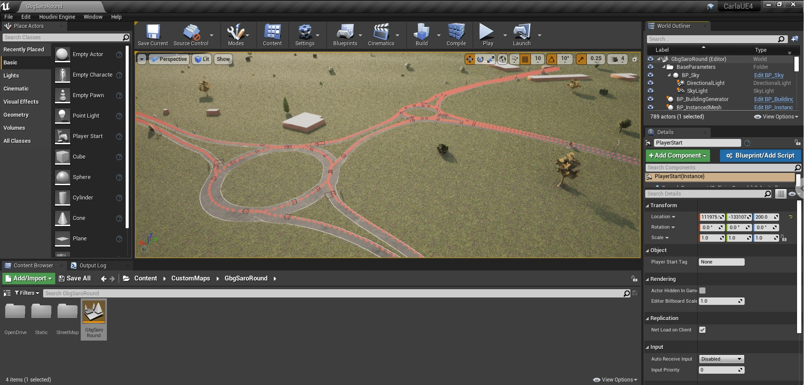
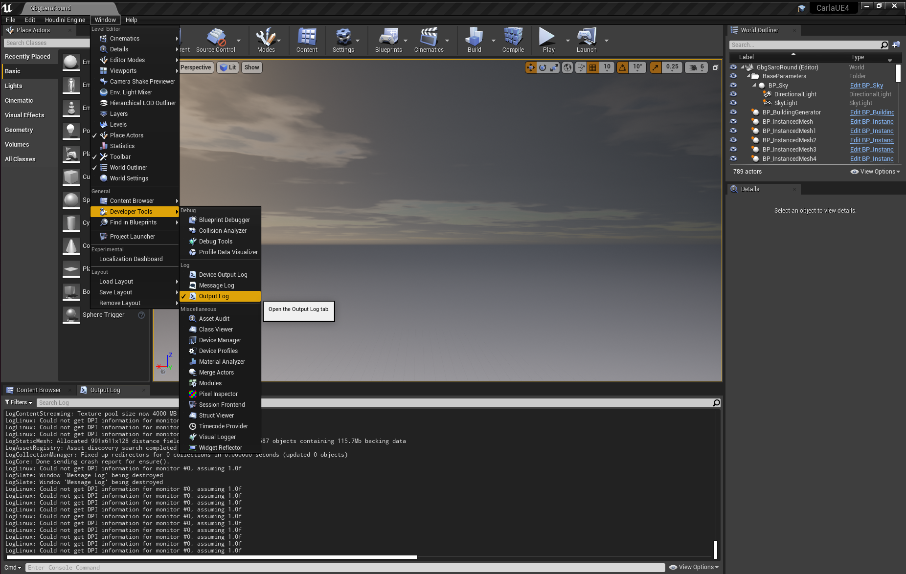
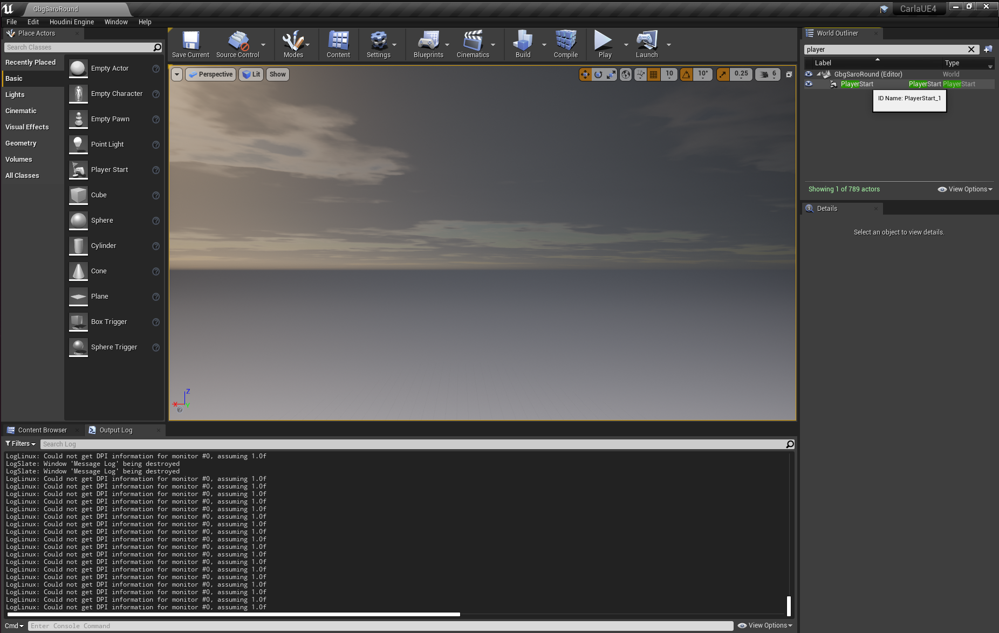
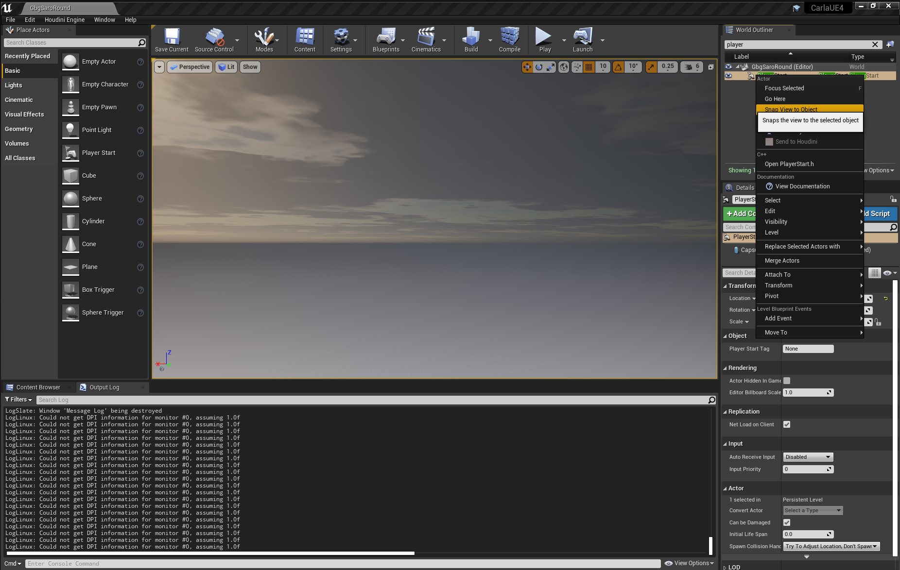

# RiDiFlo (RISE CARLA 0.9.15 Digital Twin Flow)

> [!NOTE]
> This open source project is developed by [RISE Research Institutes of Sweden](https://ri.se/). See license file for open source license information.

This repository consists of two parts:
1. A source patch for **CARLA 0.9.15** that extends CARLA's Unreal Engine map-generation workflow for creating a single-level digital twin from paired **OpenStreetMap (`.osm`)** and **OpenDRIVE (`.xodr`)** files
2. A workflow for *cooking* the digital twin map such that it can be used in CARLA 0.9.15 simulations.

The patch was developed and tested with CARLA 0.9.15, Unreal Engine 4.26, and Ubuntu 22.04. It modifies CARLA, LibCarla, CarlaTools, the bundled StreetMap plugin, and selected build and navigation components.



*Example digital twin generated in the CARLA Unreal Editor from paired OSM and XODR inputs.*

## What the patch adds

- Import of local OSM and XODR files through `CarlaTools.GenerateMap`.
- Single-level digital twin generation at a chosen Unreal content path.
- Alignment of OSM-derived environmental content with the OpenDRIVE road network.
- Import of OSM buildings, forest areas, and individual trees through the customized StreetMap plugin.
- Improved road surfaces, terrain integration, lane markings, roundabout markings, and bidirectional center lines.
- Selectable bidirectional center-line styles.
- More deterministic multithreaded road and junction mesh generation.
- Improved tree placement near road edges and junction approaches.
- Selected CARLA Python navigation changes used to test generated maps.

> [!NOTE]
> The patch contains more than the minimum digital-twin generator changes. Review the changes under `PythonAPI/` before using the patch in a production or research branch.

---

# Part 1: Generating a Digital Twin

## Prerequisites

- Ubuntu 22.04 + installation of build tools requirements from [CARLA 0.9.15 Linux build guide, Software Requirements](https://carla.readthedocs.io/en/0.9.15/build_linux/#part-one-prerequisites:~:text=UE4-,Software%20requirements)
- Unreal Engine 4.26 configured for CARLA + setting the Unreal Engine environment variable, following the official [CARLA 0.9.15 Linux build guide, Unreal Engine](https://carla.readthedocs.io/en/0.9.15/build_linux/#part-one-prerequisites:~:text=Unreal%20Engine,-Starting).
- A matching `.osm` and `.xodr` pair for the same geographic area

## 1. Clone the CARLA source

Clone CARLA and check out that commit:

```bash
git clone https://github.com/carla-simulator/carla.git
cd carla
git checkout --detach d7b45c1e159e6d13296f7a3a4e8b13e6c2d62c18
```


## 2. Update CARLA content

Before applying the digital-twin source patch, follow the **Get assets** or **Download the CARLA content** section of the official [CARLA 0.9.15 Linux build guide](https://carla.readthedocs.io/en/0.9.15/build_linux/).

At the time of writing, the default CARLA content URL used by `Update.sh` is not serving the CARLA 0.9.15 content archive. Apply the small content URL workaround patch first:

```bash
git apply --whitespace=error-all \
  /path/to/carla-0.9.15-content-url.patch
```

The content URL patch also updates CARLA's Boost and LibPNG download URLs in `Util/BuildTools/Setup.sh`. At the time of writing, the upstream Boost URL redirects to an HTML page instead of the Boost source archive, and the upstream LibPNG URL returns `404 Not Found`.

Then run:

```bash
./Update.sh
```

## 3. Build and launch CARLA Editor

Before applying the digital-twin source patch, build and launch the CARLA Unreal Editor:

```bash
make launch ARGS="--editor-flags -norelativemousemode"
```

The `-norelativemousemode` option is useful on Linux machines accessed through remote desktop software because it can avoid mouse capture and cursor movement problems in Unreal Editor.

For a standard local launch, use:

```bash
make launch
```

To retain a build log:

```bash
make launch 2>&1 | tee build.log
```

## 4. Apply the patch

After CARLA content has been downloaded and the editor has built successfully, stop the editor. Then apply the digital-twin source patch from the CARLA repository root:

```bash
git apply --whitespace=error-all \
  /path/to/carla-0.9.15-digital-twin.patch
```

### Existing `StreetMap` symlink

The patch includes this case-sensitive symbolic link:

```text
Unreal/CarlaUE4/Plugins/StreetMap -> Unreal/CarlaUE4/Plugins/Streetmap
```

If `git apply` reports:

```text
error: Unreal/CarlaUE4/Plugins/StreetMap: already exists in working directory
```
remove only the link and apply the patch again:

```bash
rm Unreal/CarlaUE4/Plugins/StreetMap

git apply --check --whitespace=error-all \
  /path/to/carla-0.9.15-digital-twin.patch

git apply --whitespace=error-all \
  /path/to/carla-0.9.15-digital-twin.patch
```

## 5. Launch patched CARLA Editor

Build and launch the patched editor with:

```bash
make launch ARGS="--editor-flags -norelativemousemode"
```

For a standard local launch, use:

```bash
make launch
```

To retain a build log:

```bash
make launch 2>&1 | tee build.log
```

If the patched build reports stale Unreal build output or generated-file errors, clear the previous editor build output first:

```bash
rm -rf Unreal/CarlaUE4/Intermediate
rm -rf Unreal/CarlaUE4/Binaries
rm -rf Unreal/CarlaUE4/Saved

find Unreal/CarlaUE4/Plugins \
  -mindepth 2 -maxdepth 2 \
  \( -name Intermediate -o -name Binaries \) \
  -exec rm -rf {} +
```

Then rebuild:

```bash
make launch 2>&1 | tee build.log
```

## 6. Prepare the OSM and XODR inputs

The OSM and XODR files must describe the same geographic area and use compatible georeferencing. Misaligned inputs can place roads, buildings, terrain, forests, or trees at incorrect offsets.

- Use OSM for buildings, forests, individual trees, and other environmental features.
- Use XODR for authoritative road topology, lanes, junctions, and geometry.
- With both files provided, `-PreferXODRWhenBothProvided=true` uses XODR for the road network while retaining OSM-derived environmental features.

### Generate and edit XODR with OpenRoadEditor

This workflow used [das-rise/open-road-editor](https://github.com/das-rise/open-road-editor) to edit the OSM road network and generate the corresponding `.xodr` file supplied to the CARLA commandlet.

A typical workflow is:

1. Clone and install OpenRoadEditor by following its repository instructions.
2. Load the source `.osm` file.
3. Inspect and edit the OSM road network.
4. Generate or refresh the OpenDRIVE representation.
5. Verify lane geometry, road connectivity, junctions, roundabouts, and georeferencing.
6. Retain matching files such as:

   ```text
   MyDigitalTwin.osm
   MyDigitalTwin.xodr
   ```

7. Pass both absolute file paths to `CarlaTools.GenerateMap`.

If the OSM road network is changed, regenerate the XODR file before running CARLA map generation again.

## 7. Generate a digital twin

### Step 1: Open CARLA Editor

Launch the editor and wait until the CARLA project is fully loaded.

### Step 2: Open the Unreal Output Log

In Unreal Editor, open:

```text
Window > Developer Tools > Output Log
```



The console command field appears at the bottom of the Output Log next to the `Cmd` label.

### Step 3: Execute the map-generation command

General form:

```text
CarlaTools.GenerateMap -LocalOSMFilePath="/path/to/MyDigitalTwin.osm" -LocalXODRFilePath="/path/to/MyDigitalTwin.xodr" -PreferXODRWhenBothProvided=true -GenerateSingleLevelMap=true -SingleLevelBoundsPadding=1500 -BaseLevelName="/Game/CustomMaps/MyDigitalTwin" -ForceOverwrite=true -RedrawLaneMarkings=false -TerrainRoadBlendDistance=6 -TerrainRoadClearance=0.02 -BidirectionalCenterLineMarking=WhiteBroken
```

Example:

```text
CarlaTools.GenerateMap -LocalOSMFilePath="$HOME/open-road-editor/examples/GbgSaroRound/GbgSaroRound.osm" -LocalXODRFilePath="$HOME/open-road-editor/examples/GbgSaroRound/GbgSaroRound.xodr" -PreferXODRWhenBothProvided=true -GenerateSingleLevelMap=true -SingleLevelBoundsPadding=1500 -BaseLevelName="/Game/CustomMaps/GbgSaroRound" -ForceOverwrite=true -RedrawLaneMarkings=false -TerrainRoadBlendDistance=6 -TerrainRoadClearance=0.02 -BidirectionalCenterLineMarking=WhiteBroken
```

Every option must have a leading hyphen. For example:

```text
-RedrawLaneMarkings=false
-BidirectionalCenterLineMarking=WhiteBroken
```

## Generation options

### Input files

- `-LocalOSMFilePath="..."`: Absolute path to the OpenStreetMap file.
- `-LocalXODRFilePath="..."`: Absolute path to the OpenDRIVE file.

### Generation settings

- `-PreferXODRWhenBothProvided=true`: Uses OpenDRIVE geometry when both OSM and XODR are available.
- `-GenerateSingleLevelMap=true`: Generates the map in one Unreal Engine level.
- `-SingleLevelBoundsPadding=1500`: Adds padding around the generated map boundary.
- `-BaseLevelName="/Game/CustomMaps/Name"`: Sets the Unreal package path for the generated map.
- `-ForceOverwrite=true`: Replaces previously generated content at the target path.

### Road and terrain settings

- `-RedrawLaneMarkings=false`: Preserves the generated or source-driven lane-marking workflow instead of running a later redraw pass.
- `-TerrainRoadBlendDistance=6`: Controls blending between roads and surrounding terrain.
- `-TerrainRoadClearance=0.02`: Sets vertical clearance between road surfaces and terrain.
- `-BidirectionalCenterLineMarking=WhiteBroken`: Creates broken white center lines on supported bidirectional roads.

Supported center-line values include:

```text
None
YellowSolid
WhiteBroken
```

## 8. Open and inspect the generated map

The generated assets are stored under the package path supplied through `-BaseLevelName`. For the example command, the path is:

```text
/Game/CustomMaps/GbgSaroRound
```

Open the generated map in the Content Browser.

If the digital twin is not visible in the viewport, locate the `PlayerStart` actor.

First, type `player` in the **World Outliner** search field:



Right-click `PlayerStart` and select **Snap View to Object**:



The editor viewport should move to the generated area.

---

# Part 2: Cooking the Map

The generated map is not yet loadable in a packaged CARLA. The `map_cooking/`
folder contains the scripts to *cook* it (in Unreal Engine terms) into an importable package and bring it
into a running CARLA installation. See
[`map_cooking/README.md`](map_cooking/README.md) for the full instructions.

---

## Acknowledgments

This software was developed as part of the [Synergies](https://synergies-ccam.eu/) project.


Funded by the European Union. Views and opinions expressed are however those of the author(s) only and do not necessarily reflect those of the European Union or European Climate, Infrastructure and Environment Executive Agency (CINEA). Neither the European Union nor the granting authority can be held responsible for them.

- [CARLA Simulator](https://carla.org/)
- [CARLA 0.9.15 Linux build documentation](https://carla.readthedocs.io/en/0.9.15/build_linux/)
- [das-rise/open-road-editor](https://github.com/das-rise/open-road-editor)
- Unreal Engine
- OpenStreetMap contributors
- OpenDRIVE ecosystem and map-authoring tools
- StreetMap plugin contributors
